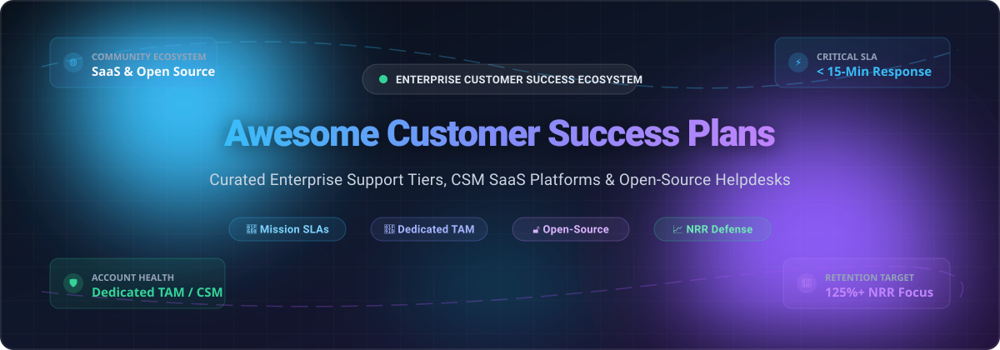
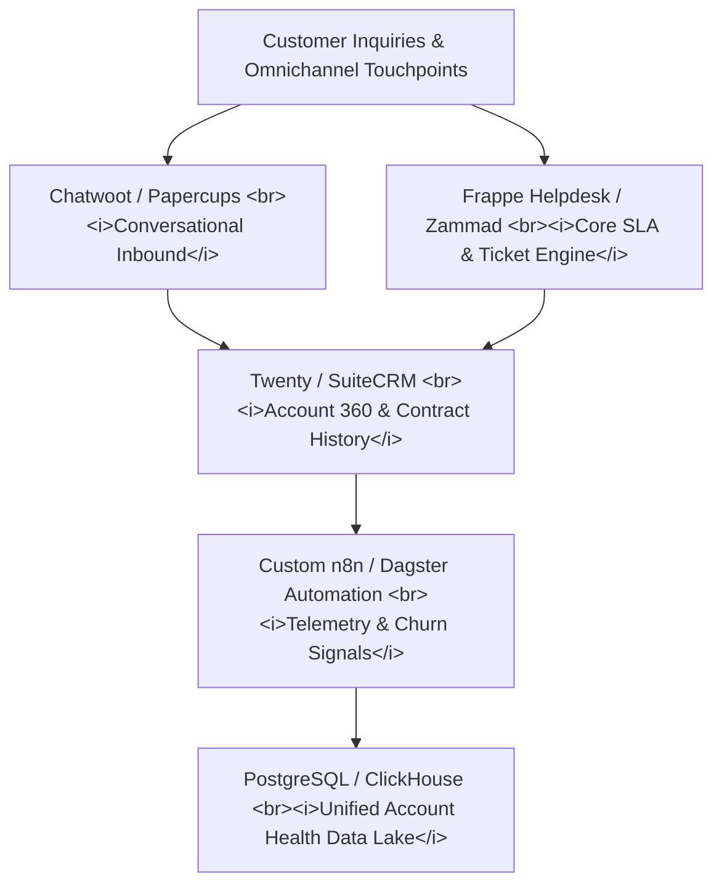

  

  
  
  
  
  
  
  

---

# 🌟 Awesome Enterprise Customer Success Plans

> **A definitive, SEO-optimized directory of Enterprise Customer Success Plans, Customer Success Management (CSM) platforms, SLA frameworks, and self-hosted open-source support software.**

Whether you are evaluating vendor support tiers, establishing a Customer Success organization, architecting net revenue retention (NRR) workflows, or deploying a self-hosted ticketing and adoption stack, this repository compiles verified data, market valuations, tier pricing, free limits, and open-source alternatives.

---

## 📑 Table of Contents

- [📊 Sector Overview & Market Dynamics](#-sector-overview--market-dynamics)
- [🏢 SaaS & Hosted Platforms](#-saas--hosted-platforms)
  - [Enterprise Customer Success Plans & CSM Matrix](#enterprise-customer-success-plans--csm-matrix)
- [🔓 Open-Source GitHub Projects](#-open-source-github-projects)
  - [Ranked by GitHub Stars](#ranked-by-github-stars)
  - [Architectural Blueprint for Custom CS Platforms](#architectural-blueprint-for-custom-cs-platforms)
- [🤝 How to Contribute](#-how-to-contribute)
- [⚖️ Disclaimer](#️-disclaimer)
- [📈 Star History](#-star-history)
- [💖 Support & Sponsoring](#-support--sponsoring)

---

## 📊 Sector Overview & Market Dynamics

The global **Customer Success Platform & Enterprise Support Services market** is currently valued between **$2.6 Billion and $3.4 Billion**, with broader Customer Success Management operations scaling beyond **$7.2 Billion** and projected to reach **$24+ Billion by 2035** at a **13.0%–21.8% CAGR**. This growth is primarily propelled by the enterprise migration toward subscription and usage-based software models, where Net Revenue Retention (NRR) and churn mitigation dictate company survival.

The sector demonstrates a **moderately fragmented competitive landscape** rather than an outright winner-take-all monopoly:
- **Cloud & Enterprise Tech Titans** (*Microsoft, AWS, Google Cloud, Salesforce, ServiceNow, SAP, Oracle*) package high-touch support tiers, mission-critical response SLAs, and designated Technical Account Managers (TAMs) as strategic retention moats.
- **Dedicated Pure-Play CSM Vendors** (*Gainsight, Totango, ChurnZero, Planhat, Vitally*) drive specialized client health scoring, predictive churn analytics, and multi-channel customer lifecycle orchestration.
- **Self-Hosted Open-Source Platforms** (*Twenty, Odoo, ERPNext, Chatwoot, UVdesk, Zammad*) empower developer and support teams seeking complete data sovereignty, localized regulatory compliance (GDPR/HIPAA), and zero per-seat licensing penalties.

---

## 🏢 SaaS & Hosted Platforms

The table below catalogs enterprise customer success offerings and pure-play CSM platforms, sorted by **Company Size / Valuation (Descending)**. Every entry contains concrete starting pricing and explicit free tier or trial limitations.

### Enterprise Customer Success Plans & CSM Matrix

| 🏢 SaaS Platform & Provider | 📈 Company Size (Valuation / Revenue) | 🎯 Key Enterprise Success Offerings & Tiers | 💵 Starting Tier Pricing (Specific) | 🎁 Free Tier / Free Trial Limits (Specific) |
| :--- | :--- | :--- | :--- | :--- |
| **[Microsoft Unified Support](https://www.microsoft.com/licensing/docs/)** *(Microsoft Corporation)* | **$3.12 Trillion** Market Cap *(FY24 Rev: $245.1B)* | 24/7 reactive break-fix prioritized resolution, Designated Account Management, Azure Support (Developer, Standard, ProDirect), Flex Add-ons | **$50,000/year minimum contract** for Unified Enterprise *(or Azure Developer Support from **$29/month**, Standard at **$100/month**)* | **Free Forever Basic Support** included with every Microsoft account (unlimited billing/subscription queries, docs; 0 technical break-fix tickets); **30-day Azure trial** with $200 credits + 55+ always-free services |
| **[Google Cloud Premium Support](https://cloud.google.com/support/docs/premium)** *(Alphabet Inc.)* | **$2.15 Trillion** Market Cap *(FY24 Rev: $350.0B)* | Designated Technical Account Manager (TAM), 15-min P1 / 5-min Mission Critical P0 SLO, Event Management Service, Operational Health Reviews | **$15,000/month minimum contract** for Premium Support *(or Standard Support at **$29/month** + 3% of spend; Enhanced at **$500/month** + 3% of spend)* | **Free Forever Basic Support** for all GCP accounts (billing/account support, active assist recommendations, community help; 0 technical tickets); **90-day free trial** with $300 credits across 20+ always-free products |
| **[AWS Enterprise Support](https://aws.amazon.com/premiumsupport/plans/enterprise/)** *(Amazon.com, Inc.)* | **$1.95 Trillion** Market Cap *(FY24 Rev: $620.1B)* | Designated Technical Account Manager (TAM), 15-min critical case SLO, AWS Security Incident Response, AWS Countdown event management | **$5,000/month minimum floor** *(greater of $5,000/mo or 10% of monthly AWS spend; Developer tier starting at **$29/month**)* | **Free Forever Basic Support** for all AWS accounts (24/7 billing & account support, documentation, 0 technical break-fix tickets); **12-month free tier** plus always-free services (e.g., 1M AWS Lambda requests/month) |
| **[Oracle Premier Support](https://www.oracle.com/support/)** *(Oracle Corporation)* | **$460 Billion** Market Cap *(FY24 Rev: $53.0B)* | Single point of accountability, 24/7 My Oracle Support, proactive health checks, Platinum Services included for engineered hardware | **22% of net software license fee annually** for on-premise software *(~$10,450/year base for DB Enterprise per processor core); **0% surcharge** (included with OCI cloud consumption)* | **Always Free Tier Forever** (2 AMD Compute VMs, up to 4 Arm Ampere cores with 24GB RAM, 2 Autonomous DBs, 200GB storage); **30-day free trial** with $300 cloud credits |
| **[Salesforce Success Plans](https://www.salesforce.com/services/success-plans/)** *(Salesforce, Inc.)* | **$275 Billion** Market Cap *(FY24 Rev: $34.9B)* | Standard (Self-guided), Premier (24/7 coaching, 1-hr critical SLO), Signature (Designated CSM, 15-min SLO, 24/7 proactive telemetry monitoring) | Standard included ($0); Premier starts at **30% of net license fees** *(e.g. from **$7.50/user/month** on $25 Starter tier, or **$49.50/user/month** on Enterprise); Signature from **~$75,000/year contract*** | **Free Forever Standard Plan** with all paid licenses (unlimited Trailhead access, online cases with 2-day business SLA); **30-day free trial** of Salesforce Starter (no credit card required, up to 2 active users, full feature access) |
| **[SAP Premium Engagement](https://help.sap.com/docs/SUPPORT_CONTENT/sm/3518048023.html)** *(SAP SE)* | **$265 Billion** Market Cap *(FY24 Rev: €31.2B / $34.0B)* | SAP MaxAttention, SAP ActiveAttention, SAP ActiveEmbedded, SAP Preferred Success for Cloud, Business Process Automation Checks | **22% of net software license fee annually** on-premise; SAP Preferred Success starts at **20% of net cloud subscription value per year** *(minimum floor **~$15,000/year**)* | **SAP BTP Free Tier Forever** with monthly quotas (up to 10,000 API calls/month, 1GB memory cap per core service); **90-day evaluation trial** for enterprise tenants |
| **[Cisco Success Tracks](https://www.cisco.com/c/dam/en_us/customer-experience/pdfs/cisco-success-tracks-customer-faq.pdf)** *(Cisco Systems, Inc.)* | **$225 Billion** Market Cap *(FY24 Rev: $53.8B)* | Level 1–3 CX support, Solution Support for multi-vendor architectures, 30-min critical SLO, Ask the Experts sessions, Accelerators | Starts at **~10% to 15% of hardware/software list price annually** *(Level 1 starting at **~$150/device/year** up to enterprise subscription tiers)* | **Cisco DevNet Sandbox Access Free Forever** (reservations up to 4 hours per session); Cisco Community support forums free forever; **90-day software warranty** with bug fixes and security patches |
| **[Adobe Platinum Support](https://helpx.adobe.com/support/programs/enterprise-support-programs1.html)** *(Adobe Inc.)* | **$210 Billion** Market Cap *(FY24 Rev: $21.5B)* | 24/7/365 support for Priority 1 issues, 30-minute target response SLO, up to 10 authorized contacts, optional Technical Account Manager (TAM) | Gold support included with enterprise licenses; Platinum Support add-on starts at **~20% of annual enterprise contract value** *(minimum floor **~$25,000/year contract**)* | **14-day free trial** for Adobe Creative Cloud for Teams (full enterprise features, up to 10 user licenses); Adobe Express / Acrobat **free forever tier** with 2GB storage |
| **[ServiceNow Impact](https://www.servicenow.com/success.html)** *(ServiceNow, Inc.)* | **$195 Billion** Market Cap *(FY24 Rev: $10.0B)* | Guided, Advanced, and Total packages; AI-driven Instance Observer, Impact Squad (CSM, Platform Architect, Success Program Manager) | Impact Guided starts at **10% of Annual Contract Value (ACV)** *(typical starting entry **~$45,000/year minimum baseline**), scaling to Total at **~30% of ACV*** | **Free Forever Personal Developer Instance (PDI)** via Developer Program (full administrative developer capabilities, hibernates after 10 days of inactivity); **15-day guided enterprise sandbox trial** |
| **[Workday Success Plans](https://www.workday.com/)** *(Workday, Inc.)* | **$68 Billion** Market Cap *(FY24 Rev: $7.3B)* | Silver (included), Gold (advisory & fast-track support), Platinum (designated Success Manager, continuous optimization reviews) | Silver included with subscription; Workday Success Plans (WSP) Gold starts at **~15% of annual subscription fee** *(minimum floor **~$30,000/year**); Platinum at **~25%*** | **30-day preview tenant/sandbox access** provided during structured evaluation with Workday sales engineering *(no self-serve free forever tier)* |
| **[Gainsight CS](https://www.gainsight.com/customer-success/)** *(Gainsight)* | **$1.1 Billion** Valuation *(Vista Equity Partners)* | Customer 360, Health Scoring, Playbooks & Success Plans, Journey Orchestrator, Renewal Center, Product Experience telemetry | Starts at **$1,200/month** *($14,400/year billed annually)* for CS Essentials tier | **14-day free trial** with interactive sandbox demo data and pre-built health score templates; Gainsight Pulse Academy & Community free forever |
| **[Totango Catalyst](https://www.totango.com/)** *(Totango)* | **$350 Million** Valuation | SuccessBLOCs modular framework, automated SuccessPlays, account segmentation, churn risk alerts, customer journey tracking | Modular Growth plans start at **$249/month** *(up to 2 users, billed annually)*; Enterprise plans start at **$1,000/month** *($12,000/year)* | **Community Edition Free Forever** (supports up to 100 customer accounts and 3 team members); **14-day Enterprise trial** with full platform capabilities |
| **[ChurnZero](https://churnzero.com/)** *(ChurnZero, Inc.)* | **$220 Million** Valuation | Real-time Customer Churn Alerts, ChurnScores, Customer Plays & Automation, In-App Walkthroughs, Executive Lifecycle Dashboards | Starts at **$1,500/month** *($18,000/year billed annually)* platform base fee | **14-day guided proof-of-concept trial** with active integration testing; ChurnZero Academy certification & courses free forever |
| **[Planhat](https://www.planhat.com/)** *(Planhat AB)* | **$180 Million** Valuation | Customer Data Platform (CDP) for CS, Health Metrics, Lifecycle Workflows, Customer Portals, Revenue Forecasting & Renewal Management | Basic tier starts at **$500/month** *($6,000/year billed annually)*; Professional tier starts at **$1,250/month** *($15,000/year)* | **14-day free trial** for up to 3 team members with interactive sandbox environment; free guided product tour |
| **[Vitally](https://www.vitally.io/)** *(Vitally Inc.)* | **$130 Million** Valuation | Collaborative Customer Success Platform, Docs & Project Management, Real-time Telemetry, Automated Playbooks, Hubs for Customers | Starter tier starts at **$299/month** *($3,588/year billed annually)*; Growth tier starts at **$600/month** *($7,200/year)* | **14-day full-access free trial** (no credit card required, supports up to 5 user accounts, full workflow integrations) |

---

## 🔓 Open-Source GitHub Projects

An expansive directory of open-source helpdesk systems, customer support platforms, and customer relationship infrastructure for building self-hosted, vendor-independent success platforms.

### Ranked by GitHub Stars

Sorted in strict **Descending Order** of GitHub Stars. Each repository includes a social badge linking directly to its GitHub Stargazers page.

1. **[Twenty](https://github.com/twentyhq/twenty)**   
   Modern, extensible open-source CRM and customer engagement platform built with TypeScript, React, and GraphQL. Provides visual pipeline workflows, account intelligence, custom telemetry fields, and deep API extensibility.

2. **[Odoo](https://github.com/odoo/odoo)**   
   Comprehensive enterprise business suite with a full-featured Helpdesk and Customer Relationship management suite (LGPL-3.0). Includes multi-channel ticket tracking, SLA management, automated escalation rules, customer satisfaction ratings, and customer portal access.

3. **[ERPNext](https://github.com/frappe/erpnext)**   
   Full-spectrum open-source enterprise management platform (GPL-3.0) with native Support and CRM modules. Features automated SLA compliance tracking, support tickets, maintenance schedules, warranty tracking, and customer satisfaction surveys.

4. **[Chatwoot](https://github.com/chatwoot/chatwoot)**   
   Open-source customer engagement platform (MIT) featuring an omnichannel shared inbox supporting live chat, email, SMS, WhatsApp, and social channels. Includes canned responses, CSAT surveys, bot integrations, and embeddable live widgets.

5. **[UVdesk](https://github.com/uvdesk/community-skeleton)**   
   Enterprise-ready open-source helpdesk system (MIT) built on Symfony. Features customer self-service portals, knowledge base management, ticket workflows, multi-channel support, and e-commerce integrations.

6. **[GLPI](https://github.com/glpi-project/glpi)**   
   Mature, robust open-source IT service management (ITSM) and issue ticketing platform (GPL-3.0). Supports ITIL compliance, strict SLA/OLA management, asset lifecycle tracking, automated ticket assignment, and customer project tracking.

7. **[Papercups](https://github.com/papercups-io/papercups)**   
   Open-source customer messaging platform (MIT) written in Elixir/Phoenix and React. Provides embeddable chat widgets, Slack two-way sync, conversation analytics, and customer support coordination.

8. **[Zammad](https://github.com/zammad/zammad)**   
   Web-based open-source helpdesk and customer support platform (AGPL-3.0). Features multi-channel ticket integration (email, chat, telephone, social), knowledge base, customizable SLAs, collision detection, and customer self-service portals.

9. **[SuiteCRM](https://github.com/salesagility/SuiteCRM)**   
   Enterprise open-source CRM system (AGPL-3.0) alternative to Salesforce. Includes dedicated Cases module for customer ticket tracking, account history, contract renewal management, and SLA enforcement.

10. **[FreeScout](https://github.com/freescout-help-desk/freescout)**   
    Lightweight, self-hosted Help Scout and Zendesk alternative (AGPL-3.0) built with PHP/Laravel. Offers zero limitations on user seats, tickets, or mailboxes, with collision detection, push notifications, multilingual support (23+ languages), and mobile-friendly UI.

11. **[Erxes](https://github.com/erxes/erxes)**   
    Open-source experience management software (GPL-3.0) combining marketing, sales, and customer care. Features team inbox, customer relationship management, customer surveys, task management, and knowledge bases.

12. **[osTicket](https://github.com/osTicket/osTicket)**   
    Battle-tested open-source support ticket system (GPL-2.0). Seamlessly routes inquiries created via email, web forms, and phone into a multi-user web interface with auto-responder, custom fields, and SLA plans.

13. **[Chaskiq](https://github.com/chaskiq/chaskiq)**   
    Conversational marketing and customer support platform (GPL-3.0) alternative to Intercom and Drift. Features live messenger, automated onboarding bot playbooks, newsletters, and customer data enrichment.

14. **[Frappe Helpdesk](https://github.com/frappe/helpdesk)**   
    Modern, streamlined open-source ticket management platform built on the Frappe Framework with Vue.js. Features dual customer/agent portals, customizable SLAs, assignment rules, knowledge base, and production-ready Docker deployment.

15. **[Peppermint](https://github.com/Peppermint-Lab/peppermint)**   
    Clean, lightweight, modern ticket management system built on Node.js and React. Offers self-hosted ticketing, internal notes, tag management, fast search, and streamlined team workflows.

16. **[Helpy](https://github.com/helpyio/helpy)**   
    Modern, mobile-friendly customer support desk (MIT) built on Ruby on Rails. Includes multi-channel ticketing, community forums, knowledge base documentation, and multilingual translations.

17. **[Live Helper Chat](https://github.com/LiveHelperChat/livehelperchat)**   
    Open-source live support and conversational desk (Apache-2.0). Features voice/video chat, Telegram/WhatsApp/Facebook integrations, proactive invitations, and bot automation.

18. **[Trudesk](https://github.com/polonel/trudesk)**   
    Open-source helpdesk ticketing system built with Node.js and MongoDB. Provides real-time notifications via WebSockets, ticket assignment, custom reporting, and integrated knowledge base.

19. **[OpenSupports](https://github.com/opensupports/opensupports)**   
    Clean, responsive open-source ticket platform (GPL-3.0) with customer portal and knowledge base. Built with PHP and React, providing agent roles, file attachments, and self-service articles.

20. **[Znuny](https://github.com/znuny/znuny)**   
    Enterprise-grade open-source service management system (fork of OTRS, AGPL-3.0). Offers 10+ years of active development, customer self-service portals, comprehensive SLA management, ITIL support, and 3rd-party ERP/CRM integrations.

21. **[Tiledesk](https://github.com/Tiledesk/tiledesk)**   
    Open-source conversational AI and omnichannel customer support platform (MIT). Features visual chatbot builders, live chat agent routing, knowledge base integration, and multi-channel messaging.

---

### 🏗️ Architectural Blueprint for Custom CS Platforms

Organizations seeking a custom, 100% self-hosted Customer Success stack without vendor lock-in can assemble this modular reference architecture:

- **Conversational Inbound**: Deploy **Chatwoot** or **Papercups** for unified live chat, email sync, and SMS routing.
- **Ticketing & SLA Core**: Deploy **Frappe Helpdesk**, **Zammad**, or **GLPI** to enforce response times and incident escalations.
- **Account 360 & Pipeline**: Integrate **Twenty** or **ERPNext** to track contract renewal dates, license tiers, and health metrics.
- **Workflow & Automation**: Leverage **n8n** or **Temporal** to trigger automated CSM playbooks upon usage drops or license expiry dates.

---

## 🤝 How to Contribute

Contributions are welcome! Help us keep this directory accurate, comprehensive, and up-to-date:

1. 🍴 **Fork the repository** on GitHub.
2. 🌿 **Create a new branch**: `git checkout -b feature/add-new-entry`.
3. 📝 **Edit `README.md`**: Follow the established table formatting for SaaS entries (including specific starting prices and exact free trial/tier limits) or the list format for open-source projects (with shields.io social star badge linked to stargazers).
4. 🚀 **Commit your changes**: `git commit -m "feat: add [Tool Name] to ecosystem"`.
5. 📤 **Push to your branch**: `git push origin feature/add-new-entry`.
6. 📬 **Submit a Pull Request** with a concise description of the addition or update.

---

## ⚖️ Disclaimer

- This directory is a **community-curated index** created for informational, educational, and research purposes. It does not constitute a formal endorsement of any vendor, platform, or project.
- Product specifications, pricing tiers, SLAs, and market caps reflect publicly available benchmark data and are subject to change by their respective providers.
- When self-hosting open-source customer success tools handling customer data, ensure compliance with relevant privacy regulations (GDPR, CCPA, HIPAA) and maintain proper SSL encryption, backup policies, and access controls.

---

## 📈 Star History

---

## 💖 Support & Sponsoring

A heartfelt thank you to everyone exploring, starring, and contributing to the open customer success ecosystem! 

If you find this repository helpful for your organization, team, or career:
- ⭐ **Star this repository** to improve its visibility across the GitHub community.
- 🍴 **Fork and share** with fellow Customer Success Managers, TAMs, and DevOps engineers.
- ☕ **Support development**: Sponsor ongoing maintenance and research via the [GitHub Sponsors Dashboard](https://github.com/sponsors/ishandutta2007).

  

